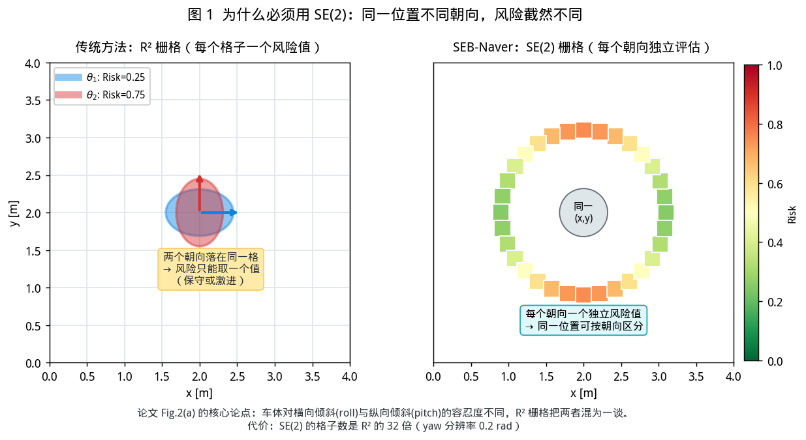
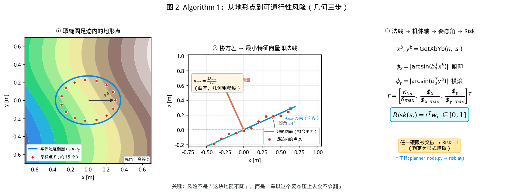
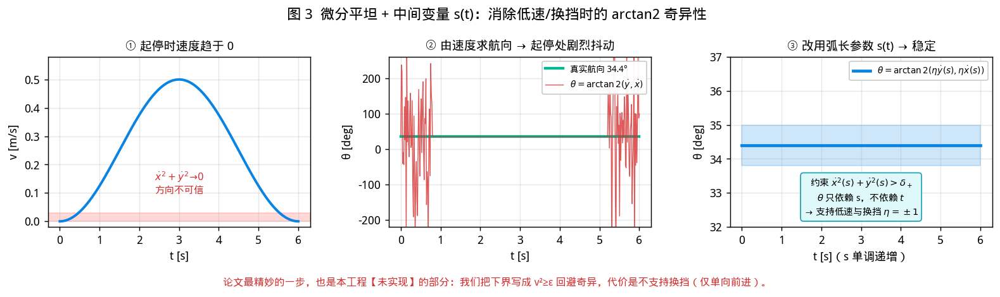
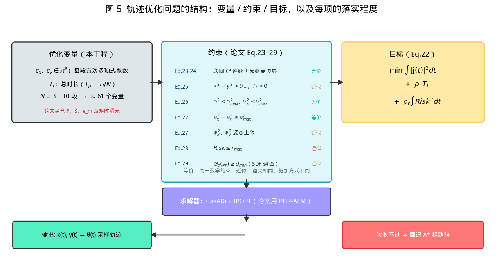
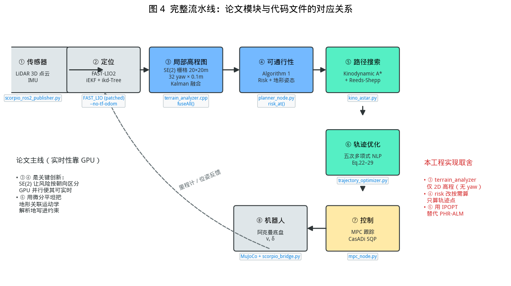

# SEB-Naver 原理讲解：论文 ↔ 本工程实现对照

> 本文回答四件事：论文解什么难题、用什么方法、公式如何驱动实现、我们的代码对应到哪一步。
> 操作层面的说明见 [HANDOVER.md](../HANDOVER.md)，本文只讲原理。
>
> 图片由 `docs/make_figures.py` 生成，可重新执行该脚本更新。

---

## 1. 论文要解决的两个难题

不平地形上的阿克曼导航，比平地多两个必须处理的环节（论文 §I）：

### 难题 A：可通行性评估会被「投影」骗

传统做法把机器人在 3D 空间的姿态**投影到 R² 栅格**上，每格存一个风险值。问题在于：



同一个 `(x, y)`，车头朝**上坡**和朝**坡侧**，车体的俯仰/横滚完全不同。而车体对这两种倾斜的**容忍度也不同**（窄车体更怕横滚）。投影到同一格后只能取一个值 —— 要么保守（能走的地方判成不能走），要么激进（会翻的地方判成能走）。

精确评估需要 `SE(3)` 状态，但维度爆炸，用离散栅格无法实时维护。

**论文的选择**：用 `SE(2)`（位置 + 朝向）作为**评估的索引**，把 `SE(3)` 姿态作为**评估的输出**。这样格子数只增加 32 倍（yaw 分辨率 0.2 rad），配合 GPU 并行可以实时。

### 难题 B：地形会改变运动学的可行域

同样的机体加速度 `ax`，上坡需要的油门比平地大（要克服重力分量）。若规划器忽略这点，输出的轨迹控制器**跟不出来** —— 表现为爬坡掉速、坡上失速、甚至溜车。

把地形关联运动学塞进优化，会让问题维度上升、非线性增强。多数工作在「效率」和「轨迹质量」之间妥协。

**论文的选择**：用**微分平坦**。关键发现是 —— 虽然地形让运动学变复杂，但机器人状态**仍可用平坦输出表示**，且地形关联约束**可以解析地写成平坦输出的函数**。于是问题规模没有爆炸。

---

## 2. 方法一：Algorithm 1 —— 从地形点到风险

这是论文的数学核心，伪代码在 §V-B。它把「这块地能不能过」变成「车以这个姿态压上去会不会翻」。



**三步几何**：

1. **取点**：以机器人位姿 `sr = (x, y, θ)` 为中心，用**车体足迹椭圆**（半轴 `ex, ey`）在高程图 `M` 上圈出地形点集 `P`。
2. **拟合**：算 `P` 的 3×3 协方差 `Cov`，做特征分解。**最小特征值对应的特征向量就是曲面法线** `z^b`；曲率由特征值比例给出：

   ```
   κ_ter = 3·λ_min / (λ_max + λ_mid + λ_min)
   ```

3. **判姿态**：由法线重建机体轴 `x^b, y^b`，投影到重力方向得俯仰/横滚：

   ```
   φx = |arcsin(b₃ᵀ x^b)|      俯仰
   φy = |arcsin(b₃ᵀ y^b)|      横滚
   ```

**两级判据**：

| 层级 | 条件 | 结果 |
|---|---|---|
| 硬限 | `κ_ter > κ_max` 或 `φx > φx_max` 或 `φy > φy_max` | **Risk = 1**（显式障碍） |
| 软融合 | 否则 | `Risk = w_rᵀ [κ/κ_max, φx/φx_max, φy/φy_max]ᵀ ∈ [0,1]` |

**本工程实现**：[`planner_node.py` → `ElevationGridParser.risk_at()`](../seb_naver_planner/seb_naver_planner/planner_node.py)

数学与伪代码逐行对应，唯一差别是**计算范围**：论文在 GPU 上算全图 1.28M 个 SE(2) 格，我们只算轨迹经过的点（约 500 μs/点）。验证方式：

```bash
/usr/bin/python3 seb_naver_planner/test/test_traversability_risk.py
# 平地 risk≈0 / 60°坡 risk=1（硬限）/ 侧坡比正坡更危险 / 未观测返回 None
```

---

## 3. 方法二：微分平坦 —— 绕开 arctan2 的 singularity

平地上，阿克曼车的非完整约束是：

```
ẋ(t)·sinθ(t) + ẏ(t)·cosθ(t) = 0        (Eq.12)
```

由此得 `θ(t) = arctan2(η·ẏ, η·ẋ)`，`η = ±1` 表示前进/后退。

**问题**：机器人起步或换挡时 `ẋ² + ẏ² → 0`，`arctan2` 的方向**在数值上不可信** —— 这一点在我们自己的数据里也能看到（图 3 中段）。



**论文的解法**：引入弧长参数 `s(t)`，把航向定义改为 `θ = arctan2(η·ẏ(s), η·ẋ(s))`，并加约束：

```
ẋ²(s) + ẏ²(s) > δ₊          (Eq.25, δ₊ > 0)
```

这样 `θ` 只依赖**几何路径** `s`，不依赖时间 `t`，在 `t` 方向上永不进入奇异点。附带好处是**支持换挡**（`η` 可切换）。

**本工程的取舍**：**未实现 `s(t)`**。我们用 `v² ≥ ε` 的数值保护回避奇异性（见 `trajectory_optimizer.py` 的 `eps_v2`），代价是**只支持单向前进**。对当前 0.5 m/s 的巡航场景够用，但不具备论文的换挡能力。

---

## 4. 公式如何驱动实现

### 4.1 优化问题的结构



### 4.2 每个约束的落实方式

| 论文 | 落实方式 | 一致性 |
|---|---|---|
| Eq.23-24 多项式连续 + 边界 | 五次多项式，段间 0~4 阶等式约束；起点位置/速度/加速度、终点位置/速度等式 | **数学等价** |
| Eq.25 `Tf > 0` | 变量上下界 `tf_min ≤ Tf ≤ tf_max` | **数学等价** |
| Eq.25 `ẋ²+ẏ² > δ₊` | 用 `v² ≥ ε`（ε=1e-4）做数值保护 | **近似**（不做换挡） |
| Eq.26 `δ² ≤ δmax²` | 转成曲率：`κ = tan(δ)/L`，约束 `κ² · (v²+ε)³ ≥ cross²` | **等价**（用 κ 表述） |
| Eq.26 `vx² ≤ vmax²` | `v² ≤ v_max²` | **数学等价** |
| Eq.27 `ax², ay²` | `ax² + ay² ≤ a_max²` | **数学等价** |
| Eq.27 `φx², φy²` | 坡度超限区当障碍（A\* 绕开）+ 轨迹姿态验收 | **近似**（不在 NLP 内） |
| Eq.28 `Risk ≤ rmax` | 轨迹逐点验收，超限则丢弃优化结果 | **语义等价** |
| Eq.29 `Gc ≥ dmin` | EDT 距离场 + outside-in 迭代排斥 | **近似**（迭代而非 NLP 内插值） |

### 4.3 为什么用迭代而不是「在 NLP 里插值」

论文在 NLP 内用三线性插值取 `Gc` 和 `Risk` 的值与梯度。我们做不到，原因是 **CasADi 3.8 的 `interpolant` 多维不可用**（实测 `n_in=1`，或返回 `nan`）。

替代方案是 **outside-in 迭代**：

```
解 NLP（无 SDF 约束）
  → 沿轨迹查间距，找违反点
  → 把违反点作为「推离障碍」的目标位置，加入二次惩罚
  → 重新求解（最多 5 轮）
  → 最终验收：min_clearance ≥ dmin − tol，否则判失败
```

代价是**约束不是严格的**，所以必须保留验收兜底 —— 这也是 `TrajResult.success` 可能在求解成功后仍为 `False` 的原因。

---

## 5. 与传统建图的区别

传统 2D 建图（`slam_toolbox` / `octomap` 2D 投影 / Nav2 costmap）与论文的 SE(2) 局部高程图，本质差异是**「地图存什么」**：

| 维度 | 传统 2D 栅格 | SE(2) 局部高程图 |
|---|---|---|
| **每格存什么** | 占用概率（0~1） | 高程 `z`、方差、可通行风险、地形法线 |
| **维度** | `(x, y)` | `(x, y, θ)` |
| **地形信息** | 无（只分有/无障碍） | 有（坡度、曲率、粗糙度） |
| **车体建模** | 圆形膨胀 | 椭圆足迹 + 姿态推导 |
| **能回答的问题** | 「这里有没有墙」 | 「车以这个朝向能安全通过吗」 |
| **更新方式** | 一次性写入 | 一维 Kalman 融合 + 马氏距离拒异常 |
| **典型失败** | 把斜坡当地面（不区分） | — |

**为什么不能直接用 2D 高程图**（如 `elevation_mapping`）？因为它每格只有一个高度，评估时**无法区分朝向**。同一个坡上的点，车头朝坡和朝坡侧的风险差 3 倍（论文 Fig.2a 的例子：Risk 0.25 vs 0.75）。SE(2) 用 32 倍的格子数换到了这个区分能力。

**代价**：格子数 ×32 → 必须 GPU 并行才能实时。这正是论文第一个贡献的动机。

---

## 6. 完整流水线：论文模块 ↔ 代码



### 6.1 数据流（一次规划周期）

```
/cloud_registered ─┐
                   ├─► terrain_analyzer: Kalman 融合 → /fused_map (elevation)
/imu/data ─────────┘                                    │
                                                        ├─► 坡度 mask（陡坡当障碍）
/Odometry (FAST-LIO2) ──────────────────────────────────┤
                                                        └─► A* 栅格
                                                             │
                                              inflation_radius=0.25 膨胀
                                                             │
                                                             ▼
                                          Kinodynamic A* + Reeds-Shepp
                                                             │
                                          ┌──────────────────┴────────┐
                                          ▼（异步线程）                ▼
                              五次多项式 NLP (IPOPT)            直接用粗路径
                                          │                          │
                                          ▼                          │
                              验收：clearance / attitude / risk      │
                                          │                          │
                                          └────────► /planner/trajectory
                                                             │
                                                             ▼
                                                    MPC (CasADi SQP)
                                                             │
                                                             ▼
                                                       /cmd_vel → 车轮
```

### 6.2 关键设计：为什么优化是异步的

单次 NLP 求解 0.4~2.5 s，而 FSM 定时器是 50 Hz。同步调用会阻塞 40 个周期（期间不判到达、不响应重规划）。

因此 `plan()` 只跑 A\*（约 49 ms）并立即返回，优化任务交给单线程 executor。**最坏情况只是「晚一次重规划才用上优化轨迹」**，不会卡住 FSM。

---

## 7. 哪里不吻合（诚实清单）

| 项 | 论文 | 本工程 | 影响 |
|---|---|---|---|
| **求解器** | PHR-ALM（增广拉格朗日） | IPOPT（内点法） | 问题形式相同，解应在同一局部最优；PHR-ALM 的优势在超大规模，我们 N≤10 用不上 |
| **SE(2) 地图** | 每格 × 32 朝向 | 只有 2D 高程 | 不算全图 risk，只对轨迹点按需算 → 不参与 A\* 全图搜索 |
| **s(t) 参数化** | 有，支持换挡 | 无，仅单向前进 | 低速/换挡场景不适用 |
| **约束施加** | NLP 内三线性插值 | 迭代排斥 + 事后验收 | 严格性略弱，故保留 `success=False` 兜底 |
| **risk 使用** | 进目标 `ρr∫Risk²` + 约束 | 仅轨迹验收 | 不改路径形状，只否决不安全的解 |
| **分段点 P** | 优化变量 | free 模式下是变量，默认 hard 固定 | 弯道曲率上限受限于固定分段 |

---

## 8. 如何自己验证

```bash
cd seb_naver_planner
source /opt/ros/humble/setup.bash && source /develop/scorpio_mujoco_sim_ws/install/setup.bash

# Alg.1 的数学性质（7 项）
/usr/bin/python3 test/test_traversability_risk.py

# Eq.22/25/26/27 是否真的被满足（5 项：直线/L弯/S弯/U形/真实A*）
/usr/bin/python3 test/test_trajectory_optimizer.py

# SDF 避障（6 项）
/usr/bin/python3 test/test_trajectory_optimizer_sdf.py

# 地形姿态（6 项）
/usr/bin/python3 test/test_terrain_attitude.py

# planner 异步集成（3 项）
/usr/bin/python3 test/test_planner_optimization.py
```

**测试断言就是检验方法**。例如 SDF 测试要求 `min_clearance ≥ dmin − tol` 且「障碍物内采样点数 = 0」，这直接验证了 Eq.29 是否真的生效。

---

## 9. 一句话总结

论文的两个贡献可以这样理解：

1. **Map 侧**：格子从 `(x,y)` 变成 `(x,y,θ)`，让风险能按朝向区分；用 GPU 承担 32 倍的计算量。
2. **Plan 侧**：用微分平坦把地形关联运动学**解析地**写进约束，并引入 `s(t)` 消除低速/换挡的数值奇异。

本工程实现了侧 1 的**数学**（Alg.1 的 CPU 按需版）和侧 2 的**大部分**（缺 `s(t)`），并补齐了论文未细述的工程环节（异步接入、验收兜底、参数整定）。三个实质差异是：**求解器换了、SE(2) 只算轨迹点、不支持换挡**。
