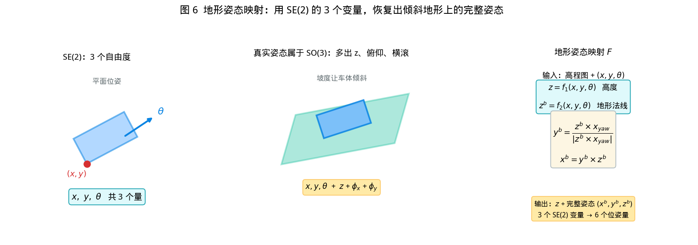
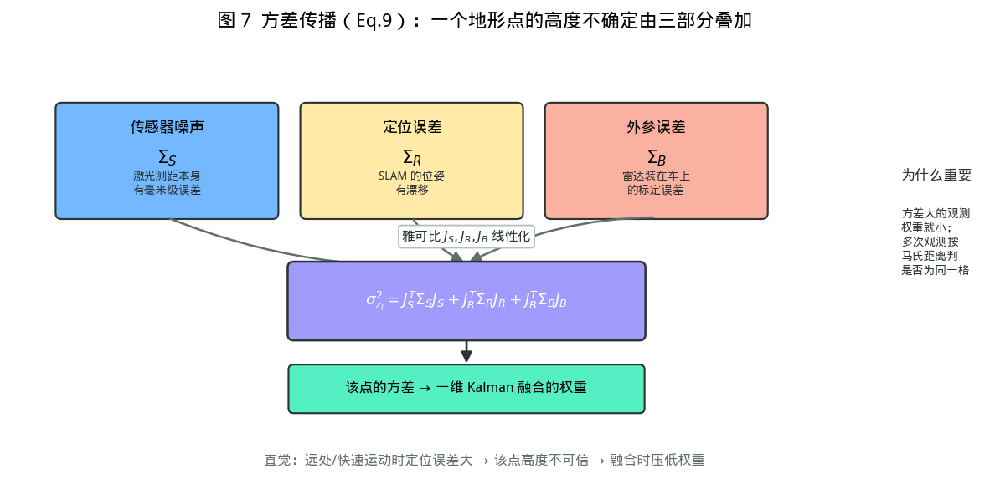
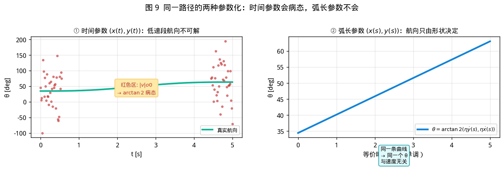
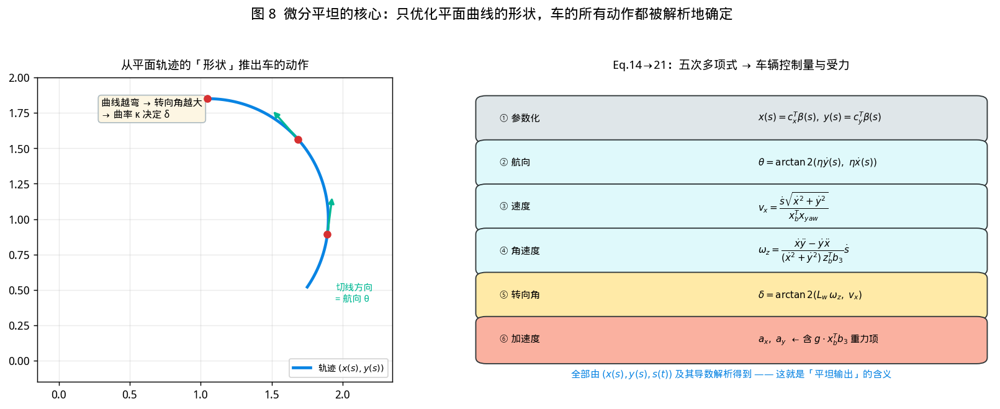

# SEB-Naver 详解教程：从零读懂论文的每个公式

> 本文面向**没接触过这个方向**的读者。目标：读完能自己解释论文的每一行公式在做什么、为什么必须这么做。
>
> 前置知识不要求，但需要能看懂「导数」和「矩阵乘法」。所有概念都会在 §0 补齐。
>
> 配套图见 `docs/figures/`（由 `docs/make_figures.py` 生成）。
> 简版对照见 [PRINCIPLE.md](PRINCIPLE.md)，操作说明见 [HANDOVER.md](../HANDOVER.md)。

---

## 目录

- [0. 先把 6 个概念说清楚](#0-先把-6-个概念说清楚)
- [1. 论文的叙事：一句话版本](#1-论文的叙事一句话版本)
- [2. 第 III 节：地形姿态映射（最关键的一步）](#2-第-iii-节地形姿态映射最关键的一步)
- [3. 第 V 节：局部建图与方差](#3-第-v-节局部建图与方差)
- [4. 第 V-B 节：Algorithm 1 可通行性](#4-第-v-b-节algorithm-1-可通行性)
- [5. 第 VI 节：轨迹规划（微分平坦）](#5-第-vi-节轨迹规划微分平坦)
- [6. 优化问题：Eq.22–29 逐条拆解](#6-优化问题eq2229-逐条拆解)
- [7. 求解：PHR-ALM 到底是什么](#7-求解phr-alm-到底是什么)
- [8. 本工程实现到哪里、为什么](#8-本工程实现到哪里为什么)
- [9. 自测题](#9-自测题)

---

## 0. 先把 6 个概念说清楚

### 0.1 SE(2) 和 SO(3)

- **SE(2)**：平面上的「位置 + 朝向」。一辆车在平地上，只需要 `(x, y, θ)` 三个数就能完全描述它 —— 这就是 SE(2)。
- **SO(3)**：三维空间中的「旋转」。不平地形上，车会**俯仰**（pitch）、**横滚**（roll），加上朝向（yaw），共三个角 —— 这是 SO(3)。
- **SE(3)**：位置 + 完整旋转，6 个自由度。

**为什么这个区分是全篇的基础**：3 个数 vs 6 个数。计算量差一个数量级。

### 0.2 协方差矩阵

一堆点，怎么用一个矩阵概括它们的分布？

```
协方差 Cov = (1/n) Σ (pᵢ − p̄)(pᵢ − p̄)ᵀ
```

- 对角元 = 各方向的**方差**（越大越散）
- 非对角元 = 各方向的**相关性**

直觉：如果点分布在一个倾斜的薄片上，那么沿薄片方向方差大，垂直薄片方向方差小。

### 0.3 特征值与特征向量（本文最核心的工具）

对协方差做特征分解 `Cov = V Λ Vᵀ`：

- **特征值 λ**：三个互相垂直方向上的方差大小，按升序 λ₁ ≤ λ₂ ≤ λ₃
- **特征向量 v**：那三个方向

关键推论：**最小特征值 λ₁ 对应的方向 v₁，就是点云最“薄”的方向 —— 也就是平面的法线。**

为什么？因为平面上的点，在法线方向几乎没有分布（方差≈0），在面内分布很广。

> 这一条是 Algorithm 1 的全部数学基础。

### 0.4 非完整约束（nonholonomic constraint）

阿克曼车**不能横着走**。数学表述：

```
ẋ·sinθ − ẏ·cosθ = 0
```

含义：速度矢量 `(ẋ, ẏ)` 必须与车头方向 `(cosθ, sinθ)` 平行，没有侧向分量。

这个约束看似简单，但它让「路径不能任意设计」—— 你必须考虑车能不能转得过来。

### 0.5 微分平坦（differential flatness）

一个系统如果存在一组「平坦输出」，使得**系统的所有状态和控制量都能由这组输出及其有限阶导数代数地表示**，就叫微分平坦。

对平地阿克曼车：平坦输出就是 `(x, y)`。
- 给定了平面轨迹 `x(t), y(t)`
- 航向由 `θ = arctan2(ẏ, ẋ)` 唯一确定
- 速度由 `v = √(ẋ²+ẏ²)` 确定
- 转向角由曲率确定
- 加速度由二阶导确定

**这就是为什么轨迹优化只需优化 `x(t), y(t)`** —— 其他量都是「免费」算出来的。

平坦的好处：优化变量少（2 个函数而不是 5 个），约束可以写在输出上而不是状态上。

### 0.6 一维 Kalman 融合

同一个格子被多次观测，每次测得的高度 `z₁, z₂, ...` 各有方差 `σ₁², σ₂², ...`。怎么合并？

```
最优估计 = Σ(zᵢ/σᵢ²) / Σ(1/σᵢ²)
```

方差小的观测权重大。这就是 Kalman 滤波在一维标量下的形式（本质是加权平均）。

---

## 1. 论文的叙事：一句话版本

> 不平地形上，**车能不能过**取决于车的姿态（不只是地面陡不陡），而**车的姿态**又由地形决定。论文做的是：把「地形 → 姿态 → 风险」这条链算清楚（Alg.1），再把姿态反过来写进轨迹优化（微分平坦），让规划出的轨迹车真的开得出来。

论文把它拆成四个模块：

| 模块 | 输入 | 输出 | 难点 |
|---|---|---|---|
| 定位（LIO） | LiDAR + IMU | 位姿 | 论文直接用 FAST-LIO2 |
| 局部建图 | 点云 + 位姿 | 高程图 + 风险图 | SE(2) 格子太多，需 GPU |
| 规划 | 风险图 + 目标 | 轨迹 | 地形关联运动学 |
| 控制 | 轨迹 | 速度/转向 | 论文用 MPC |

**两个真正的创新**在建图和规划（对应 §V、§VI）。

---

## 2. 第 III 节：地形姿态映射（最关键的一步）

### 2.1 问题

不平地形上，车有 6 个自由度。如果直接用 SE(3) 做规划，变量太多、约束太复杂。

但仔细想：车的姿态其实**不是自由的** —— 它由地形决定。给定位置和朝向，车会「趴」在地面上，高度和倾角就定了。

### 2.2 定义



论文定义映射 `F : SE(2) → R × S²₊`：

```
z   = f₁(x, y, θ)          车的中心高度
zᵇ  = f₂(x, y, θ)          地形法线（单位向量，朝上）
```

然后由法线构造完整姿态：

```
yᵇ = (zᵇ × x_yaw) / ‖zᵇ × x_yaw‖       式(2)
xᵇ = yᵇ × zᵇ                            式(3)
```

其中 `x_yaw = [cosθ, sinθ, 0]ᵀ` 是航向在平面上的方向。

### 2.3 公式在说什么（逐行）

**式(2)** 的想法：
- `zᵇ` 是地面法线（朝上）
- `x_yaw` 是车头在水平面上的投影方向
- 两者叉乘，得到一个既垂直于法线、又垂直于水平朝向的向量 → 这正是**车体的横向轴** `yᵇ`
- 归一化是因为叉乘结果的长度取决于夹角

**式(3)**：车体的前向轴 `xᵇ = yᵇ × zᵇ`。两个已知的正交轴叉乘，得到第三个。

**为什么这样构造是对的**：我们要的是一个右手正交基 `[xᵇ, yᵇ, zᵇ]`，其中 `zᵇ` 必须是地面法线（车贴着地），`xᵇ` 要与 `x_yaw` 尽量一致（车头朝向不变）。上式正好满足。

### 2.4 这个映射解决了什么

| 不用映射 | 用映射 |
|---|---|
| 优化变量：6 个自由度的位姿 | 优化变量：3 个（x, y, θ） |
| 约束：非完整 + 姿态 | 约束：非完整 |
| 计算量：大 | 计算量：小 3 倍以上 |

**代价**：`f₁, f₂` 是地形决定的**非线性函数**，不可解析求导。所以论文的做法是**查表**（高程图的插值）。

### 2.5 本工程怎么做的

我们的 `terrain_analyzer` 只维护 2D 高程（没有 yaw 维度），所以 `f₁` 是近似的（用当前格的均值）。姿态的精确计算放在 `risk_at()` 里做（见 §4）。

---

## 3. 第 V 节：局部建图与方差

### 3.1 地图怎么跟着车移动（式 4）

```
p_M = l_res · [ floor(x/l_res), floor(y/l_res), 0 ]
```

**含义**：地图原点不连续移动，而是**量化**到栅格。车走一段距离，地图整体跳一格，然后把移出去的格子标为 unknown。

**为什么这样设计**：避免地图频繁重采样（每次移动一点就全部重算）。

### 3.2 一个点的高度从哪来（式 5-8）



一个激光点 `p_l`（在 LiDAR 坐标系下），转成地图高度：

```
z_l = b₃ᵀ p_l = b₃ᵀ( ᴮ_R( ˢ_R p_l + p_BS ) − p_B )        式(5)
```

符号含义（下标表示坐标系）：

| 符号 | 含义 |
|---|---|
| `p_l` | 点在 LiDAR 系的坐标（原始测量） |
| `ˢ_R` | LiDAR → 地图系的旋转（来自定位） |
| `ᴮ_R` | 机体 → 地图系的旋转（来自定位） |
| `p_BS` | LiDAR 在机体上的安装位置（外参） |
| `p_B` | 机体位置（来自定位） |
| `b₃` | `[0,0,1]ᵀ`，取 z 分量 |

**式(5) 在做什么**：原点是 LiDAR，先转到地图系，再减去机体位置，最后取高度。就是把「激光测到的点」放到地图上。

### 3.3 为什么要算雅可比（式 6-8）

激光测距有噪声、定位有漂移、外参有误差。**这三者都会让算出的高度不准**。要量化不准的程度，需要知道「输入变一点，输出变多少」→ 这就是**雅可比矩阵**（偏导数矩阵）。

```
J_S = ∂z_l/∂ˢp_l  = (ᴮ_R ˢ_R)ᵀ b₃
J_R = ∂z_l/∂ᴮ_R    = (ᴮ_R p_l + p_BS)ᵀ ᴮ_R b₃^∧
J_B = ∂z_l/∂p_B    = −b₃
```

**逐项直觉**：

- **`J_S`**：激光测距误差怎么传导到高度。只与旋转有关（旋转决定方向）。
- **`J_R`**：定位姿态误差的影响。**距离越远（`p_l` 越大），影响越大** —— 这就是「远处的点更不可靠」的数学表达。
- **`J_B`**：定位位置误差的影响。方向是 `−b₃`（位置高一点，点就相对低一点），系数为 1。

### 3.4 方差合成（式 9）

```
σ²_zl = J_Sᵀ Σ_S J_S + J_Rᵀ Σ_R J_R + J_Bᵀ Σ_B J_B
```

**含义**：三个独立误差源，各自通过雅可比「放大」后，方差相加。

> 这是经典的误差传播公式 `Var(f(x)) ≈ J Var(x) Jᵀ` 在三项独立源上的展开。

### 3.5 融合（一维 Kalman + 马氏距离）

有了 `z_l` 和 `σ²_zl`，就能做加权融合（见 §0.6）。

**马氏距离**解决的问题：多个点落在同一格，怎么判断它们是「同一处地形」还是「两个不同的物体（比如树和地面）」？

```
d² = (z − μ)ᵀ σ⁻² (z − μ)
```

若 `d²` 太大（超过阈值 2.5），说明这个点与已有估计差异过大，**拒绝更新**。否则按 Kalman 融合。

**这一步是防止「树冠被写成地面高度」的关键。**

---

## 4. 第 V-B 节：Algorithm 1 可通行性

### 4.1 为什么需要它

高程图只告诉你「地面多高」，不告诉你「车能不能过」。同一块地：
- 缓坡 → 能过
- 陡坡 → 上不去
- 侧坡 → 会翻
- 崎岖 → 颠簸失控

### 4.2 算法整体


```
输入: 高程图 M, 状态 sᵣ=(x,y,θ), 椭圆半轴 (eₓ, e_y), 权重 wᵣ, 硬限 κmax, φxmax, φymax
输出: Risk(sᵣ) ∈ [0,1], 地形法线 zᵇ

① P ← 椭圆足迹内的地形点
② p̄ ← P 的均值
③ Cov ← (1/|P|) Σ (pⱼ − p̄)(pⱼ − p̄)ᵀ
④ zᵇ, κ_ter ← 最小特征向量 + 曲率
⑤ if κ_ter > κmax: return (1, zᵇ)
⑥ xᵇ, yᵇ ← 由 zᵇ 构造机体轴
⑦ φx ← |arcsin(b₃ᵀxᵇ)|,  φy ← |arcsin(b₃ᵀyᵇ)|
⑧ if φx > φxmax or φy > φymax: return (1, zᵇ)
⑨ r ← [κ_ter/κmax,  φx/φxmax,  φy/φymax]ᵀ
⑩ return rᵀwᵣ
```

### 4.3 逐步推导

**① 为什么要椭圆而不是圆**

车体是长方形（约 0.42 × 0.30 m）。用椭圆近似足迹，比圆更贴合。

关键是：**椭圆相对于 `θ` 旋转**。所以同一个 `(x,y)`，`θ` 不同 → 覆盖的地形点不同 → 风险不同。**这就是 SE(2) 的意义所在。**

**④ 曲率公式怎么来的**

`κ_ter = 3·λ₁ / (λ₁+λ₂+λ₃)`

- `λ₁` 是法线方向的方差（应该接近 0）
- 分母是总方差

比率 `λ₁/Σλ` 越小 → 点越「扁平」→ 地面越平。
乘 3 是归一化：三个方向的方差都相等时（完全无结构），`λ₁/Σλ = 1/3`，乘 3 得 1（最大曲率）。

**⑤ 为什么曲率超限直接判死**

曲率大意味着地形在足迹范围内剧烈起伏 → 车会剧烈颠簸 → 不认为可通行。这是**保守但安全**的选择。

**⑥→⑦ 姿态角怎么算**

`φx = |arcsin(b₃ᵀ xᵇ)|`

- `b₃ᵀ xᵇ` 是 `xᵇ` 在竖直方向的**投影长度**
- 若 `xᵇ` 完全水平，投影 = 0，`arcsin(0) = 0` → 无俯仰
- 若 `xᵇ` 倾斜 30°，投影 = sin30° = 0.5，`arcsin(0.5) = 30°`

所以 `arcsin(b₃ᵀxᵇ)` 就是**车体前向轴与水平面的夹角** = 俯仰角。同理 `φy` 是横滚角。

**⑨ 为什么用比值 + 加权和**

三个量纲不同的物理量（曲率 1/m、两个角度 rad）不能直接相加。用各自的硬限做归一化，得到三个 `[0,1]` 的无量纲数，再用权重融合。

**权重 `wᵣ` 的物理含义**：`wᵣ = [w_κ, w_φ, w_φ]`。论文默认曲率权重更高（0.6 vs 0.2），因为崎岖比倾斜更容易导致失控。

### 4.4 为什么横滚比俯仰更危险

`φxmax = 0.786 rad (45°)`，而 `φymax = 1.571 rad (90°)`？

看起来横滚限制更宽松。但注意**车体尺寸**：车长 0.42 > 车宽 0.30。侧倾时，重心横向偏移的杠杆比纵向短 → 实际上**更容易翻**。

论文的硬限是保守的外层保护，真正的危险度由 `wᵣ` 的加权项体现。

### 4.5 本工程实现

`planner_node.py` 的 `risk_at()`，逐行对应上面的伪代码。验证：

```bash
/usr/bin/python3 seb_naver_planner/test/test_traversability_risk.py
```

---

## 5. 第 VI 节：轨迹规划（微分平坦）

### 5.1 车辆运动学（式 10-11）

```
ṗ_B = v_x · xᵇ                              式(10)
ᴮṘ  = ᴮ_R ⌊ (v_x tanδ / L_w) · zᵇ ⌋         式(11)
```

- **式(10)**：车只沿自身前向轴运动 → 这就是非完整约束的物理解释
- **式(11)**：车的姿态变化率。`v_x tanδ / L_w` 就是**角速度** `ω_z`（自行车模型的经典结论），`zᵇ` 是旋转轴（地形法线）
- `⌊·⌋` 表示把向量转成反对称矩阵（用于表示叉乘）

> **推导 `ω = v·tanδ/L`**：后轮不转向，前轮转 δ。转弯时，车的瞬时旋转中心在后方延长线上，转弯半径 `R = L/tanδ`。角速度 `ω = v/R = v·tanδ/L`。

### 5.2 非完整约束（式 12）与它的麻烦

```
ẋ(t) sinθ(t) − ẏ(t) cosθ(t) = 0              式(12)
```

这个等式约束在优化里很麻烦：它是「等式」，而大多数优化求解器对等式约束的处理不如对不等式灵活。

更麻烦的是：**低速时它会退化**。

因为 `θ(t) = arctan2(ẏ, ẋ)`，当 `v = √(ẋ²+ẏ²) → 0` 时，`ẋ` 和 `ẏ` 都趋近 0，比值失去意义 → `arctan2` 输出剧烈抖动。



### 5.3 论文的解法：引入 s(t)（式 13-16）

思路：**航向不应该由速度决定，而应该由路径的形状决定。**

把平面轨迹参数化成 `(x(s), y(s))`，`s` 是**弧长**（沿路径走过的距离）。那么：

```
θ = arctan2(η·ẏ(s), η·ẋ(s))                  (式13)
```

- `η = ±1` 表示前进/后退
- 注意：`θ` 只依赖 `s` 的导数，**不依赖时间**

然后加一个约束：

```
ẋ²(s) + ẏ²(s) > δ₊       (δ₊ > 0)            式(25)
```

含义：路径在 `s` 方向上的「速度」不能为零。这很自然 —— 一条路径总要有长度。

**于是 arctan2 永远在非零处求值**，奇异性被彻底消除。

**副作用（好事）**：因为 `θ` 与 `t` 解耦，可以自由地让 `s(t)` 的变化率是正或负，也就自然支持了**换挡**。

### 5.4 参数化（式 14-16）

用**分段五次多项式**表示：

```
x_i(s) = c_xᵢᵀ β(s),   s ∈ [0, s(T_p) − s(0)]     式(14)
y_i(s) = c_yᵢᵀ β(s)                                 式(15)
s_i(t) = c_sᵢᵀ β(t),   t ∈ [0, T_p]                 式(16)
```

其中 `β(·) = [1, ·, ·², ·³, ·⁴, ·⁵]ᵀ` 是自然基，`c ∈ R⁶` 是系数。

**为什么用五次（而不是三次）**：
- 三次多项式能保证**加速度**连续
- 五次能保证**加加速度（jerk）**连续 —— 这对乘坐舒适性和机械磨损很重要
- 我们要最小化的目标是 jerk 的平方积分，所以 jerk 至少要能被表示

**为什么分段**：一条长轨迹用单个五次多项式无法表达复杂形状（五次多项式最多 2 个拐点）。分段后每段独立，段间保证 C⁴ 连续（0~4 阶导都连续）。

### 5.5 从平坦输出推出所有量（式 17-21）



这是微分平坦的核心。给定 `x(s), y(s), s(t)`，所有量都能算出来：

**速度（式 17）**
```
v_x = ṡ·√(ẋ²(s)+ẏ²(s)) / (xᵇᵀ x_yaw)
```
- `√(ẋ²+ẏ²)` 是路径的「几何速度」（每单位 s 走多远）
- 乘 `ṡ` 得到实际速度
- 分母 `xᵇᵀ x_yaw` 是修正项：地形倾斜时，实际前进距离与平面投影不同

**角速度（式 18）**
```
ω_z = [(ẋÿ − ẏẍ) / ((ẋ²+ẏ²)·zᵇᵀb₃)] · ṡ
```
- `ẋÿ − ẏẍ` 是**叉乘的 z 分量**，等于 `|v|³ · κ`（曲率乘速度立方）
- 除以 `(ẋ²+ẏ²)` 后剩 `|v|·κ` —— 这就是 `ω = v·κ`
- 分母的 `zᵇᵀb₃` 是地形倾斜修正

> **这一步是纯几何**：曲线的弯曲程度决定车的转向快慢。

**转向角（式 19）**
```
δ = arctan2(L_w·ω_z, v_x)
```
- 由自行车模型 `ω = v tanδ/L` 反解：`tanδ = Lω/v`
- 用 `arctan2` 而不是 `arctan`，是为了处理 `v_x` 为负（倒车）的情况

**纵向加速度（式 20）**
```
a_x = [ṡ²·v_dsᵀ a_ds + s̈·v_dsᵀ v_ds] / (√(ẋ²+ẏ²)·xᵇᵀx_yaw)  +  g·xᵇᵀb₃
```

拆开看：
- 第一项：路径形状带来的加速度（切向加速度）
- 第二项：`g·xᵇᵀb₃` —— **重力分量**

**最后这项就是论文 Fig.2(b) 的核心**：上坡时 `xᵇ` 有向上的分量，重力产生额外的阻力。要维持同样的 `a_x`，电机必须输出更多力。规划器若忽略这项，轨迹会「要求」一个车做不到的加速度。

**横向加速度（式 21）**
```
a_y = [(ẋÿ − ẏẍ)/√(ẋ²+ẏ²)] · ṡ²  +  g·yᵇᵀb₃
```
- 第一项：向心加速度（转弯产生）
- 第二项：重力的横向分量 → **这是侧翻的根源**

### 5.6 小结：为什么这一步很关键

| 不用微分平坦 | 用微分平坦 |
|---|---|
| 变量：位姿 6 + 控制 2 = 8 个函数 | 变量：x, y, s 三个函数 |
| 约束：运动学方程作为等式 | 约束：直接写在 x, y, s 上 |
| 地形关联：难处理 | 重力项 `g·xᵇᵀb₃` 解析可算 |

---

## 6. 优化问题：Eq.22–29 逐条拆解


### 6.1 目标函数（式 22）

```
min  ∫ j(t)ᵀj(t) dt  +  ρ_t·T_f  +  ρ_r·∫ Risk²(s_r(t)) dt
     └─── jerk ───┘    └─ 时间 ─┘    └──── 风险 ────┘
```

**三项在权衡什么**：

| 项 | 物理意义 | 增大权重的后果 |
|---|---|---|
| `∫j²` | 加加速度平方积分（越小越平滑） | 轨迹更柔，但可能更慢 |
| `ρ_t T_f` | 总时间（越小越快） | 更快，但可能更急 |
| `ρ_r ∫Risk²` | 累计风险（越小越安全） | 更安全，但可能绕远 |

**为什么用 jerk 而不是加速度**：加速度最小化会得到「bang-bang」控制（开关式），反而机械冲击大。jerk 最小化能得到平滑过渡。

### 6.2 等式约束（式 23-24）

```
M_p(S)·c_p = b_p(P, e_m)          式(23)
M_s(T_f)·c_s = b_s(S), T_f > 0    式(24)
```

**这两条在说什么**：多项式系数 `c` 不是自由的，必须满足：
- 段间连续（0~4 阶导在连接点吻合）
- 起点/终点的位置、速度、加速度
- 换挡点 `e_m` 的边界条件

`M_p` 是一个大矩阵（约 `6N×6N`），`b` 是右端项（由分段点 `P` 决定）。

**论文的技巧**：在优化前先「消元」—— 用 `M_p⁻¹ b_p` 把系数 `c` 表示成 `P, S, e_m` 的函数。这样**优化变量从「6N 个系数」变成「N 个分段点」**，维度大幅下降。

> 代价：需要保证 `M_p` 可逆。论文的做法是「强制起终点和换挡点的二阶导为零」，从而保证可逆。

### 6.3 不等式约束（式 25-29）

| 式 | 约束 | 含义 | 为什么必要 |
|---|---|---|---|
| 25 | `ẋ²+ẏ² ≥ δ₊`, `T_f > 0` | 路径有长度、时间为正 | 消除 arctan2 奇异、时间无意义 |
| 26 | `δ² ≤ δmax²` | 转向角限幅 | 机械极限 |
| 26 | `v_x² ≤ v_max²` | 速度限幅 | 电机/安全极限 |
| 27 | `a_x² ≤ a_max²`, `a_y² ≤ a_max²` | 加速度限幅 | 抓地力/舒适性 |
| 27 | `φ_x² ≤ φxmax²`, `φ_y² ≤ φymax²` | 姿态角限幅 | 防侧翻 |
| 28 | `Risk(s_r) ≤ r_max` | 风险限幅 | 显式障碍判定 |
| 29 | `G_c(s_r) ≥ d_min` | SDF 距离 | 与障碍物保持距离 |

**注意**：这些都是**平方形式**。为什么？因为 `x² ≤ a²` 等价于 `−a ≤ x ≤ a`，一个不等式就能表达双边约束，而且处处可导（`|x|` 在 0 处不可导）。

### 6.4 时间离散化

连续时间上的约束是无穷多个。做法：每段分成 K 个时间点，只在这些点上施加约束。

```
t̃_p = (p/K)·T_p,   p = 0..K−1
```

**K 的选择是权衡**：K 小 → 约束稀疏 → 约束之间的时间点可能违反；K 大 → 计算慢。

> 我们实测过：K=6 时曲率约束会在段内被违反（κ 冲到 14，限值 2.7）。所以按弧长自适应加密到 ~0.1m 一个点。

---

## 7. 求解：PHR-ALM 到底是什么

### 7.1 为什么需要特殊的求解器

优化问题有：
- 约 60~120 个变量
- 大量非线性约束（三角函数、平方、曲率公式）
- 部分约束非凸（曲率约束）

通用的 NLP 求解器（如 IPOPT）可以解，但论文追求大规模实时，所以用了 **PHR-ALM**。

### 7.2 增广拉格朗日法（ALM）的基本思想

约束优化 `min f(x) s.t. h(x)=0, g(x)≤0`

解法：把约束「罚」到目标里：

```
L(x, λ, μ) = f(x) + λᵀh(x) + (μ/2)‖h(x)‖²
```

- `λ` 是拉格朗日乘子（线性项，估计约束「值多少」）
- `μ` 是罚参数（二次项，惩罚违反）

**迭代流程**：
```
给定 λ, μ
  解无约束问题 min L(x, λ, μ)  → x*
  更新 λ ← λ + μ·h(x*)          （乘子法）
  增大 μ                        （PHR 的更新策略）
直到 ‖h(x*)‖ ≈ 0
```

**PHR** = Powell-Hestenes-Rockafellar，指这三个人提出的一种特定的乘子更新规则。相比朴素 ALM，它对 `μ` 的增长更温和，数值更稳定。

### 7.3 为什么我们用 IPOPT 替代

| | PHR-ALM | IPOPT |
|---|---|---|
| 类型 | 外点法（罚函数） | 内点法（障碍函数） |
| 适合规模 | **超大**（数万变量） | 中等（数百变量） |
| 约束处理 | 罚项 | 对数障碍 |
| 优势 | 可拆分并行 | 收敛快、对初值不敏感 |

我们的规模是 60~120 变量，IPOPT 更合适，且实现成本低（CasADi 自带）。**问题形式相同，所以得到的解应该在同一个局部最优附近**。

---

## 8. 本工程实现到哪里、为什么

### 8.1 完整的实现映射

| 论文 | 本工程 | 差异 |
|---|---|---|
| §III 地形姿态映射 | `ElevationGridParser.attitude_at()` | 只做 2D 高程，无 yaw 维度 |
| §V-A 建图 + Kalman | `terrain_analyzer.cpp` | 简化版融合（单点覆盖，非加权） |
| Eq.9 方差传播 | 未实现 | 不用于融合权重 |
| §V-B Alg.1 | `planner_node.py: risk_at()` | 数学一致，**按需算**而非全图 |
| §VI-A 参数化 | `trajectory_optimizer.py` | 未用 s(t)，用 t 参数化 |
| Eq.17-21 平坦输出 | 部分：v, κ 约束 | 无重力项 `g·xᵇᵀb₃` |
| Eq.22 目标 | jerk + ρt·Tf | 无 ρr·∫Risk² 项（用验收代替） |
| Eq.23-24 等式 | 段间 C⁴ + 边界 | 不做矩阵消元，直接优化系数 |
| Eq.25-29 不等式 | 全部实现 | 部分用验收而非 NLP 约束 |
| PHR-ALM | IPOPT | 同问题，不同解法 |

### 8.2 三个关键取舍及原因

**取舍 1：不用 s(t)，用 t 参数化**

- 原因：s(t) 需要额外推导 `ṡ` 与 `v` 的关系，实现复杂度高
- 代价：不支持换挡，低速时用 `v² ≥ ε` 数值保护
- 影响范围：0.5 m/s 单向前进场景无差异

**取舍 2：risk 按需算而非全图**

- 原因：CPU 全图实测 **12.3 秒/次**（1.28M 格 × 49 邻域 × 特征分解），即使加 OpenMP + 跳过无高程格 + yaw 降采样也不够
- 做法：只对轨迹经过的点算（~500 μs/点）
- 代价：risk 不参与 A\* 全图搜索，只做轨迹验收

**取舍 3：约束用「迭代 + 验收」而非 NLP 内插值**

- 原因：CasADi 3.8 的 `interpolant` 多维不可用（实测 `n_in=1` / 返回 `nan`）
- 做法：解 NLP → 查违反点 → 加排斥惩罚 → 重解（5 轮）
- 代价：约束不严格，必须靠最终验收兜底（所以有 `success=False` 但求解成功的情况）

### 8.3 我们补齐的工程环节

论文没细说、但工程上必须有的：

| 环节 | 为什么需要 |
|---|---|
| 异步优化 | 求解 0.4~2.5s，同步会阻塞 50Hz FSM |
| 验收兜底 | 约束不严格，必须检查最终结果 |
| 车体膨胀 | A\* 只看格子占用，不看车体尺寸 |
| 轨迹裁剪 + 重采样 | 优化轨迹点距 4cm，MPC 视界会被压缩 |
| 诊断脚本 | 现场问题需要可复现的信息 |

---

## 9. 自测题

读完应该能回答：

1. **为什么不能直接用 2D 高程图做导航？**
   <details><summary>答案</summary>
   每格只有一个高度，无法区分朝向。同一坡上，车头朝坡和朝坡侧的风险差 3 倍（0.25 vs 0.75），2D 图无法表达。
   </details>

2. **Algorithm 1 里为什么「最小特征向量」是法线？**
   <details><summary>答案</summary>
   平面上的点，在法线方向几乎无分布（方差≈0），在面内分布广。所以最小特征值对应的方向就是法线。
   </details>

3. **`arcsin(b₃ᵀxᵇ)` 为什么等于俯仰角？**
   <details><summary>答案</summary>
   `b₃ᵀxᵇ` 是车体前向轴在竖直方向的投影长度，即 `sin(倾角)`。所以 `arcsin` 反解出倾角。
   </details>

4. **式 18 的分母为什么有 `zᵇᵀb₃`？**
   <details><summary>答案</summary>
   地形倾斜时，实际的旋转轴是地形法线 `zᵇ` 而非竖直轴 `b₃`。投影 `zᵇᵀb₃ = cos(地形倾角)`，用于把平面角速度换算成绕法线的角速度。
   </details>

5. **式 20 的重力项 `g·xᵇᵀb₃` 为什么重要？**
   <details><summary>答案</summary>
   上坡时车体前向轴有向上的分量，重力产生额外阻力。规划器若不考虑，会要求一个车做不到的加速度 → 轨迹不可跟踪。
   </details>

6. **引入 s(t) 解决了什么具体问题？**
   <details><summary>答案</summary>
   低速时 `√(ẋ²+ẏ²)→0`，`θ=arctan2(ẏ,ẋ)` 数值病态。改用 s 后 `θ` 只依赖路径形状，与时间解耦，永不受速度影响；顺带支持换挡。
   </details>

7. **为什么约束都写成平方形式？**
   <details><summary>答案</summary>
   `x² ≤ a²` 等价于双边约束 `−a≤x≤a`，一条式子表达两边；且处处可导（`|x|` 在 0 处不可导，会让求解器卡住）。
   </details>

8. **论文用 PHR-ALM，我们用 IPOPT，结果会一样吗？**
   <details><summary>答案</summary>
   问题形式相同，都是解同一个 NLP。若问题是凸的，解唯一；非凸时可能收敛到不同局部最优。我们的规模小（60~120 变量），IPOPT 通常能找到好的解，且有验收兜底。
   </details>
